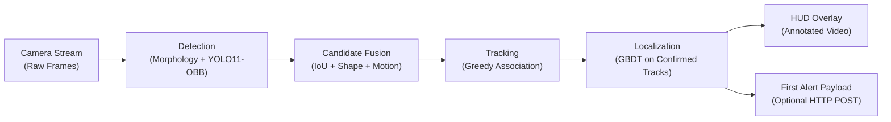

# AI-Based Drone Detection, Localization & Tracking System

[](https://www.python.org/)
[](https://github.com/astral-sh/uv)
[](https://github.com/ultralytics/ultralytics)
[](https://www.raspberrypi.com/)
[](tests/)

A drone detection, geolocation, and multi-object tracking pipeline built for the **TESA Top Gun Rally 2025 – Defensive Track** (11–13 Nov 2025). It combines classical morphological target extraction with YOLO11 Oriented Bounding Box (OBB) detection, fuses the two candidate sets, tracks drones across video frames, estimates each confirmed drone's latitude, longitude, and altitude from its image geometry with gradient-boosted decision trees (GBDT), and renders a HUD overlay plus a First Alert telemetry payload. The design targets CPU-only edge hardware (Raspberry Pi 5, no AI accelerator).

This repository is a cleaned-up, unit-tested reimplementation of the original competition code. [Results](#results) states where each figure comes from and what it was evaluated on.


*Unedited pipeline output on competition footage (`P1_VIDEO_5`, 8 s, cropped and scaled 0.9×; overlays untouched): both drones keep IDs 1 and 2 throughout. Elsewhere in the footage, birds and other specks occasionally produce short-lived false tracks.*

---

## Architecture Overview



---

## 5-Stage Processing Pipeline


1. **Stage 1 (Raw Input)**: Full-resolution frame from the fixed ground-station camera.
2. **Stage 2 (Binarization & Morphology)**: Grayscale thresholding separates bright sky from dark targets; the mask is inverted, dilated with a 50×50 kernel to merge fragmented rotor blobs, then eroded and closed before contours are area-gated.
3. **Stage 3 (Detection & Fusion)**: YOLO11-OBB runs on a copy of the frame with the background dimmed and the OSD timestamp banner and foliage band masked out; its boxes are fused with the morphological candidates using IoU, shape-plausibility, and motion scores.
4. **Stage 4 (Multi-Object Tracking)**: Greedy nearest-centroid association. A track is confirmed after 3 matched detections and kept alive through up to 30 missed frames, so IDs can survive short dropouts.
5. **Stage 5 (HUD & Localization)**: Confirmed tracks get GBDT-estimated latitude, longitude, and altitude (MSL), drawn on the output video with the track ID and its fusion score (a heuristic 0–1 score from Stage 3, not a calibrated detector probability).

---

## Quick Start (with `uv`)

All environments and dependencies are managed via [`uv`](https://github.com/astral-sh/uv):

```bash
# 1. Clone repository and initialize virtual environment
uv sync --extra dev

# 2. Review model setup instructions
# (See models/README.md for downloading or training models)

# 3. Run video tracking
uv run python scripts/track_video.py input.mp4 -o output_tracked.mp4

# 4. Run full unit test suite
uv run pytest tests/ -v
```

---

## System Modules

| Module | Core Scripts | Description |
| :--- | :--- | :--- |
| **1. Detection** | [`scripts/detect_images.py`](scripts/detect_images.py)<br>[`scripts/tune_confidence.py`](scripts/tune_confidence.py) | Morphological candidate extraction + YOLO11-OBB inference, optional SAHI sliced inference for small targets, and a confidence-threshold sweep tool. |
| **2. Localization** | [`scripts/localize_drones.py`](scripts/localize_drones.py)<br>[`scripts/train_gbdt.py`](scripts/train_gbdt.py) | 20-dimensional image-geometry features (normalized position, box size and aspect, radial/polar terms, corner distances) fed to 3 independent GBDT regressors for latitude, longitude, and altitude. |
| **3. Tracking & Telemetry** | [`scripts/track_video.py`](scripts/track_video.py)<br>[`scripts/generate_submission.py`](scripts/generate_submission.py) | Stateful multi-target tracking, HUD overlay rendering, and a First Alert JSON payload builder (Base64 frame + per-track coordinates) with optional HTTP POST dispatch, disabled by default. |

---

## Results

> **Where these numbers come from.** Rows marked *archived* are recovered from the logs of the original competition runs (November 2025) and were produced by the original code. Rows marked *re-run* were measured with this repository's code and shipped weights. Official competition scores were computed on a private test set (no public leaderboard) and are not part of the archive.

| Area | Metric | Result | Evaluated on |
| :--- | :--- | :--- | :--- |
| **Detection, held out** (*re-run*): shipped YOLO11n-OBB, `models/yolo11n-obb.pt` | mAP@50; competition F1 (IoU ≥ 0.25) | **72.5%**; F1 **0.53** at conf 0.50 (recall 90%, precision 38%) | 15 test images (10 drones) of the `drone.v5i` Roboflow dataset, never used in training; raw detector on 460×460 crops. All 15 false positives are one stationary rooftop fixture, flagged in every image; there are no others. Reproduce with `uv run python scripts/eval_detection_holdout.py --dataset <drone.v5i dir>` (dataset from the competition archive) |
| **Detection, validation** (*archived*): same model (`best.pt`, epoch 74) | mAP@50 / mAP@50-95 | 99.5% / 85.3% (precision 100%, recall 99.4%) | 21-image validation split used for checkpoint selection; 5 of its frames are interleaved with training frames of the same video |
| **Drone counting** (*archived*): SAHI + YOLO11-OBB | Exact per-image count accuracy | **77.08%** (74/96 images), count RMSE 0.568 | 96 labeled sample images. Best point of a confidence sweep (conf = 0.75) chosen on the same images. The checkpoint used isn't recorded, and 19 of the images are in the `drone.v3`/`drone.v4` training split |
| **Localization, held out** (*re-run*): shipped inference path, GBDTs refit per fold | Competition weighted error (0.70 × angle + 0.15 × height + 0.15 × range; lower is better) | **7.8** under blocked 5-fold CV (mean angle 5.3°, height 8.6 m, range 18.8 m); 3.6 under random 5-fold | 416 of 438 labeled images (22 had no detection). The images are consecutive frames of 4–5 flights, so blocked CV, which holds out contiguous frame ranges, is the honest estimate. Random folds mostly test interpolation between near-duplicate neighbouring frames. Reproduce with `uv run python scripts/cv_localization.py` |
| **Throughput** (*re-run*): full tracking pipeline, default config | End-to-end frames per second on 1080p video | **≈ 10 FPS** (10.2–10.4 median across runs; 95.7 ms/frame median, 106 ms p95) | Desktop Intel Core i5-14500 CPU, Windows 11, no GPU. Measured on `P1_VIDEO_4`/`P1_VIDEO_5`, 24 timed runs of 600 frames each. About half of each frame is the pre-YOLO `clean_image` step (48 ms), against 24 ms for YOLO11n-OBB. **Not a Raspberry Pi measurement.** Reproduce with `uv run python scripts/benchmark_pipeline.py <videos>` |

The archive's localization figures (3.33 weighted error; 2.93 m altitude MAE) are a training-set score and a random split over the same sequential frames, so they are optimistic. See [`docs/02_drone_localization.md`](docs/02_drone_localization.md) §5.

**Pipeline behaviour worth knowing:** on the localization images, YOLO fires on the cleaned frame in only 60 of 438 images. 86% of the boxes used for localization come from the morphology branch, whose 50×50 dilation inflates box size. On video, boxes switch between tight YOLO boxes and loose morphology boxes, which makes the altitude readout jitter.

**Not quantitatively evaluated:** no tracking ground truth was available, so ID switches, MOTA, and IDF1 are not reported. Qualitatively, in the two competition videos reviewed (`P1_VIDEO_4` and `P1_VIDEO_5`, about 2 minutes), every real drone kept its ID; the drones never crossed paths. Birds and other specks produced false tracks: 9 confirmed false tracks in `P1_VIDEO_4`'s 64 s, with at least one false box in about 21% of its frames. On-device throughput and latency on the Raspberry Pi 5 have not been benchmarked. In the First Alert payload, `velocity_mps` and `direction_deg` are not computed yet and are sent as `null`.

Per-run training tables, the full confidence sweep, and error distributions are in [`docs/01_object_detection.md`](docs/01_object_detection.md) and [`docs/02_drone_localization.md`](docs/02_drone_localization.md).

**Hardware:**
- **Deployment target**: Raspberry Pi 5 (ARM Cortex-A76 CPU, 4GB/8GB RAM, no dedicated GPU or AI accelerator). The nano detector and tree-based regressors were chosen for this budget.
- **Training**: CUDA GPU.

---

## Repository Structure

```
AI-Drone-Detection/
├── README.md
├── LICENSE
├── IMPLEMENTATION_PLAN.md              # File-by-file reimplementation plan
├── pyproject.toml                      # Project config for uv
├── uv.lock
├── config/
│   └── default.yaml                    # Master parameter configuration
├── defense/
│   ├── __init__.py
│   ├── config.py                       # YAML configuration loader
│   ├── detection/
│   │   ├── __init__.py
│   │   ├── image_processor.py          # Classical morphological CV pipeline
│   │   ├── yolo_detector.py            # YOLO11-OBB inference wrapper
│   │   ├── sahi_detector.py            # Slicing Aided Hyper Inference
│   │   └── confidence_tuner.py         # Automated threshold sweep optimizer
│   ├── localization/
│   │   ├── __init__.py
│   │   ├── feature_encoder.py          # 20-dim spatial feature encoder
│   │   ├── gbdt_regressor.py           # Multi-target GBDT regressor (lat, lon, alt)
│   │   ├── fusion_engine.py            # YOLO + morphology candidate fusion
│   │   └── evaluation.py               # Competition evaluation metrics
│   ├── tracking/
│   │   ├── __init__.py
│   │   ├── drone_track.py              # Stateful DroneTrack dataclass
│   │   ├── tracker.py                  # VideoTracker multi-target engine
│   │   ├── hud_renderer.py             # HUD overlay renderer
│   │   └── telemetry.py                # First Alert payload builder & dispatcher
│   └── utils/
│       ├── __init__.py
│       ├── logger.py                   # Timestamped, module-prefixed stdout logger
│       ├── video_io.py                 # Video reader/writer helpers
│       ├── image_io.py                 # Image I/O helpers
│       └── geometry.py                 # Geodesic Haversine & bearing math
├── scripts/
│   ├── detect_images.py                # Problem 1: Batch image detection
│   ├── localize_drones.py              # Problem 2: Full localization pipeline
│   ├── track_video.py                  # Problem 3: Video tracking with HUD
│   ├── train_gbdt.py                   # GBDT training script
│   ├── tune_confidence.py              # Confidence threshold optimization
│   ├── prepare_dataset.py              # Video-to-YOLO dataset creator
│   ├── generate_submission.py          # Competition CSV submission formatter
│   ├── eval_detection_holdout.py       # Held-out detection eval (mAP + competition F1)
│   ├── cv_localization.py              # Cross-validated localization evaluation
│   └── benchmark_pipeline.py           # Per-stage CPU throughput benchmark
├── notebooks/
│   └── train_yolo_obb.ipynb            # YOLO11-OBB fine-tuning notebook
├── models/
│   ├── .gitkeep
│   └── README.md                       # Model weight acquisition guide
├── docs/
│   ├── 01_object_detection.md
│   ├── 02_drone_localization.md
│   ├── 03_drone_tracking.md
│   ├── 04_edge_deployment.md
│   ├── architecture.md
│   └── assets/                         # Visual artifacts and charts
├── tests/
│   ├── test_drone_track.py
│   ├── test_feature_encoder.py
│   ├── test_fusion_engine.py
│   ├── test_gbdt_regressor.py
│   ├── test_geometry.py
│   ├── test_image_processor.py
│   └── test_tracker.py
└── .gitignore
```

---

## License

This project is licensed under the MIT License - see the [LICENSE](LICENSE) file for details.
