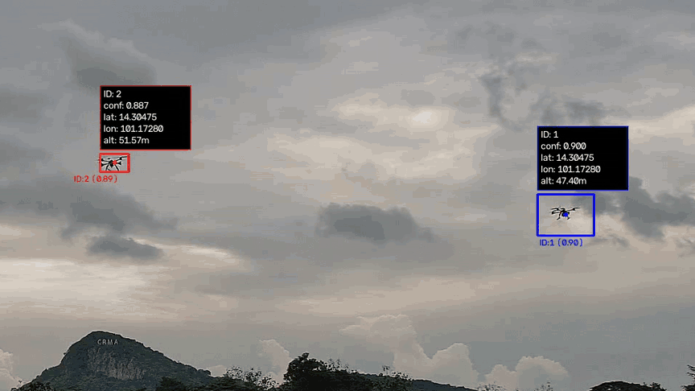
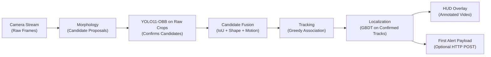

# AI-Based Drone Detection, Localization & Tracking System

[](https://www.python.org/)
[](https://github.com/astral-sh/uv)
[](https://github.com/ultralytics/ultralytics)
[](https://www.raspberrypi.com/)
[](tests/)

A drone detection, geolocation, and multi-object tracking pipeline built for the **TESA Top Gun Rally 2025 – Defensive Track** (11–13 Nov 2025):
- **Detection:** cheap morphological target extraction proposes candidates, and YOLO11 Oriented Bounding Box (OBB) detection on native-resolution crops of the raw frame confirms them.
- **Tracking:** drones are tracked across video frames.
- **Localization:** each confirmed drone's latitude, longitude, and altitude are estimated from its image geometry with gradient-boosted decision trees (GBDT).
- **Output:** a HUD overlay plus a First Alert telemetry payload.

It runs on CPU-only edge hardware: **12.5–16.9 FPS on a Raspberry Pi 5** (1080p input, NCNN backend, no AI accelerator).

This repository is a cleaned-up, unit-tested reimplementation of the original competition code, with the detection and localization bugs found during evaluation fixed. [Results](#results) states where each figure comes from and what it was evaluated on.



*Unedited pipeline output on competition footage (`P1_VIDEO_5`, 8 s, cropped and scaled 0.9×; overlays untouched). Both drones keep IDs 1 and 2 for the whole 69 s video, with no false tracks.*

---

## Architecture Overview



---

## 5-Stage Processing Pipeline


1. **Stage 1 (Raw Input)**: Full-resolution frame from the fixed ground-station camera.
2. **Stage 2 (Binarization & Morphology)**:
   - Grayscale thresholding separates bright sky from dark targets.
   - A 50×50 dilation merges fragmented rotor blobs, then erosion and closing clean the mask.
   - Contours are area-gated and the OSD timestamp banner and foliage band are excluded.
   - Each candidate also gets a **tight box** (its dark-pixel extent) for localization.
3. **Stage 3 (Detection & Fusion)**:
   - YOLO11-OBB runs on native-resolution 320 px crops of the **raw** frame around each candidate.
   - A YOLO box is kept only if a morphological candidate confirms it, which removes static scene objects (timestamp text, tree line, a stadium roof fixture) that the detector scores at 0.45–0.9 in every frame.
   - Confirmed boxes and candidates are fused using IoU, shape-plausibility, and motion scores.
4. **Stage 4 (Multi-Object Tracking)**: Greedy nearest-centroid association.
   - Only a YOLO-confirmed detection can **start** a track; morphology alone can extend one.
   - A track is confirmed after 3 matched detections and kept alive through up to 30 missed frames.
5. **Stage 5 (HUD & Localization)**: Confirmed tracks get estimated latitude, longitude, and altitude (MSL), drawn on the output video with the track ID and its fusion score.
   - The localizer regresses camera-centric bearing, distance, and height, then converts them to latitude, longitude, and altitude.
   - For YOLO boxes the fusion score is the YOLO confidence, plus 0.10 when morphology agrees. Morphology-only boxes show a heuristic shape/motion score. Neither is a calibrated probability.

---

## Quick Start (with `uv`)

All environments and dependencies are managed via [`uv`](https://github.com/astral-sh/uv):

```bash
# 1. Clone repository and initialize virtual environment
uv sync --extra dev

# 2. Put the detector at models/yolo11n-obb.pt and train the localizer
#    (see models/README.md)
uv run python scripts/train_gbdt.py --data data/p2_train

# 3. Run video tracking
uv run python scripts/track_video.py input.mp4 -o output_tracked.mp4

# 4. Run full unit test suite
uv run pytest tests/ -v
```

---

## System Modules

| Module | Core Scripts | Description |
| :--- | :--- | :--- |
| **1. Detection** | [`scripts/detect_images.py`](scripts/detect_images.py)<br>[`scripts/tune_confidence.py`](scripts/tune_confidence.py) | `DroneDetector`: morphological candidates confirmed by YOLO11-OBB on raw-frame crops (or the whole frame, configurable). It is the single detection path used by every script. Optional SAHI sliced inference and a confidence-threshold sweep tool. |
| **2. Localization** | [`scripts/localize_drones.py`](scripts/localize_drones.py)<br>[`scripts/train_gbdt.py`](scripts/train_gbdt.py) | `GeoLocalizer`: 20-dimensional image-geometry features (normalized position, box size and aspect, radial/polar terms, corner distances) feed GBDTs for bearing, distance, and height relative to the camera, converted to latitude, longitude, and altitude. Training uses the same detection path as inference. |
| **3. Tracking & Telemetry** | [`scripts/track_video.py`](scripts/track_video.py)<br>[`scripts/generate_submission.py`](scripts/generate_submission.py) | Stateful multi-target tracking, HUD overlay rendering, and a First Alert JSON payload builder (Base64 frame + per-track coordinates) with optional HTTP POST dispatch, disabled by default. |

---

## Results

> **Where these numbers come from.** Every "before / after" pair was measured with this repository's evaluation scripts on the same data. "Before" is commit `839dcdd`, the first reimplementation (YOLO on a dimmed, downscaled frame; GBDTs predicting lat/lon/alt directly). "After" is commit `09bdf99`; later commits may change these numbers. Official competition scores were computed on a private test set (no public leaderboard) and are not available.

| Area | Metric (held out) | Before | **After** | Evaluated on |
| :--- | :--- | :---: | :---: | :--- |
| **Drone detection** (Problem 1) | Competition F1, IoU ≥ 0.25 | 0.00 (0 of 10 drones) | **0.95** (9 TP, 0 FP, 1 FN) | 15 full-resolution frames whose labels (`drone.v5i` test split) were never used in training. `scripts/eval_detection_holdout.py --full-frames` |
| **Drone counting** (Problem 1) | Exact per-image count accuracy | 62.8% (27/43) | **90.7%** (39/43) | 43 labeled sample images in no training or validation split |
| **Localization** (Problem 2) | Competition weighted error (0.70 × angle + 0.15 × height + 0.15 × range; lower is better) | 8.84 | **6.96** (angle 5.2°, height 7.8 m, range 14.6 m) | Blocked 5-fold CV over all 438 labeled images; misses scored with a fallback. `scripts/cv_localization.py` |
| **Tracking** (Problem 3) | False tracks / frames showing a wrong drone count | 9 / 21.2% (`P1_VIDEO_4`)<br>3 / 7.7% (`P1_VIDEO_5`) | **2 / 5.2%**<br>**0 / 0.0%** | Full competition videos with 1 and 2 drones (manually verified constant). Real drones stay tracked in 100% of frames in both versions |
| **Throughput, desktop** | End-to-end FPS, 1080p video | 11.0–11.4 FPS | **19.4–28.0 FPS** | Desktop Intel Core i5-14500 CPU, no GPU, same videos back to back. `scripts/benchmark_pipeline.py` |
| **Throughput, Raspberry Pi 5** | End-to-end FPS, 1080p video | — | **12.5–16.9 FPS** (NCNN)<br>3.9–6.6 FPS (PyTorch) | Pi 5 8 GB, CPU only, active cooler, no throttling; includes writing the annotated video. Same held-out accuracy as the desktop for both backends. [`docs/04`](docs/04_edge_deployment.md) §1.3 |

**What changed:**
- **The detector no longer runs on a dimmed copy of the frame.** The old pre-YOLO cleaning step blinded it: on the held-out frames it found none of the drones.
- **YOLO runs on raw crops and must be confirmed by morphology**, which removes static false positives.
- **Training and inference now share one box-extraction path.** `train_gbdt.py` used to train on different boxes than inference, often the camera's timestamp text, and could not read the competition's label format.
- **The localizer predicts camera-centric quantities** instead of raw latitude, longitude, and altitude.
- **Bird- and speck-like blobs can no longer start a track** on their own.

Details, ablations, and caveats are in [`docs/01_object_detection.md`](docs/01_object_detection.md) §3, [`docs/02_drone_localization.md`](docs/02_drone_localization.md) §5, [`docs/03_drone_tracking.md`](docs/03_drone_tracking.md) §7 and [`docs/04_edge_deployment.md`](docs/04_edge_deployment.md) §1.2.

**Read these numbers with their limits:**
- **Small samples.** The detection test set is 15 frames with 10 drones, and the tracking comparison covers two videos with no crossing drones. These show large, consistent effects, but the confidence intervals are wide.
- **Localization configuration choice.** The configuration was chosen with the same cross-validation it is scored on. Re-running that choice inside every fold (nested CV) gives 7.90, still better than 8.84 (docs/02 §5.5).
- **Why blocked CV is the headline.** The localization images are consecutive frames of 4–5 flights, so blocked CV holds out whole flight segments. Random 5-fold CV gives 3.53 (was 4.79) but mostly measures interpolation between near-duplicate frames.
- **Not measured:**
  - ID switches, MOTA, and IDF1 (no tracking ground truth).
  - The First Alert payload's `velocity_mps` and `direction_deg`, which are not computed yet and are sent as `null`.
- **Archive figures are optimistic.** The original competition archive reports a 3.33 localization error and a 2.93 m altitude error. Those are a training-set score and a random split over sequential frames (docs/02 §5.1–5.3).

**Hardware:**
- **Deployment target**: Raspberry Pi 5 (ARM Cortex-A76 CPU, 4GB/8GB RAM, no dedicated GPU or AI accelerator). The nano detector, crop-based inference, NCNN runtime, and tree-based regressors were chosen for this budget. It does not reach the source video's 25 fps, so about half to two-thirds of the frames are processed live.
- **Training**: CUDA GPU.

---

## Repository Structure

```
AI-Drone-Detection/
├── README.md
├── AGENTS.md                           # Guide for coding agents (CLAUDE.md imports it)
├── CLAUDE.md
├── LICENSE
├── IMPLEMENTATION_PLAN.md              # File-by-file reimplementation plan
├── pyproject.toml                      # Project config for uv
├── uv.lock
├── config/
│   └── default.yaml                    # Master parameter configuration
├── defense/
│   ├── __init__.py
│   ├── config.py                       # YAML configuration loader
│   ├── detection/
│   │   ├── __init__.py
│   │   ├── drone_detector.py           # Shared detection path (morphology + confirmed YOLO crops)
│   │   ├── image_processor.py          # Classical morphological CV pipeline
│   │   ├── yolo_detector.py            # YOLO11-OBB inference wrapper
│   │   ├── sahi_detector.py            # Slicing Aided Hyper Inference
│   │   └── confidence_tuner.py         # Automated threshold sweep optimizer
│   ├── localization/
│   │   ├── __init__.py
│   │   ├── feature_encoder.py          # 20-dim spatial feature encoder
│   │   ├── geo_localizer.py            # Camera-centric GBDT localizer (bearing, distance, height)
│   │   ├── dataset.py                  # Labeled-image loading + shared training-sample extraction
│   │   ├── gbdt_regressor.py           # Previous lat/lon/alt GBDT regressor (kept for reference)
│   │   ├── fusion_engine.py            # YOLO + morphology candidate fusion
│   │   └── evaluation.py               # Competition evaluation metrics
│   ├── tracking/
│   │   ├── __init__.py
│   │   ├── drone_track.py              # Stateful DroneTrack dataclass
│   │   ├── tracker.py                  # VideoTracker multi-target engine
│   │   ├── hud_renderer.py             # HUD overlay renderer
│   │   └── telemetry.py                # First Alert payload builder & dispatcher
│   └── utils/
│       ├── __init__.py
│       ├── logger.py                   # Timestamped, module-prefixed stdout logger
│       ├── video_io.py                 # Video reader/writer helpers
│       ├── image_io.py                 # Image I/O helpers
│       └── geometry.py                 # Geodesic Haversine & bearing math
├── scripts/
│   ├── detect_images.py                # Problem 1: Batch image detection
│   ├── localize_drones.py              # Problem 2: Full localization pipeline
│   ├── track_video.py                  # Problem 3: Video tracking with HUD
│   ├── train_gbdt.py                   # Localizer training script
│   ├── tune_confidence.py              # Confidence threshold optimization
│   ├── prepare_dataset.py              # Video-to-YOLO dataset creator
│   ├── generate_submission.py          # Competition CSV submission formatter
│   ├── eval_detection_holdout.py       # Held-out detection eval (raw model + full pipeline)
│   ├── cv_localization.py              # Cross-validated localization evaluation
│   └── benchmark_pipeline.py           # Per-stage CPU throughput benchmark
├── notebooks/
│   └── train_yolo_obb.ipynb            # YOLO11-OBB fine-tuning notebook
├── models/
│   ├── .gitkeep
│   └── README.md                       # Model weight acquisition guide
├── docs/
│   ├── 01_object_detection.md
│   ├── 02_drone_localization.md
│   ├── 03_drone_tracking.md
│   ├── 04_edge_deployment.md
│   ├── architecture.md
│   └── assets/                         # Visual artifacts and charts
├── tests/
│   ├── test_drone_detector.py
│   ├── test_drone_track.py
│   ├── test_feature_encoder.py
│   ├── test_fusion_engine.py
│   ├── test_gbdt_regressor.py
│   ├── test_geo_localizer.py
│   ├── test_geometry.py
│   ├── test_image_processor.py
│   └── test_tracker.py
└── .gitignore
```

---

## License

This project is licensed under the MIT License - see the [LICENSE](LICENSE) file for details.
