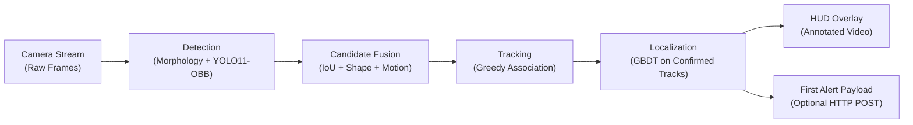
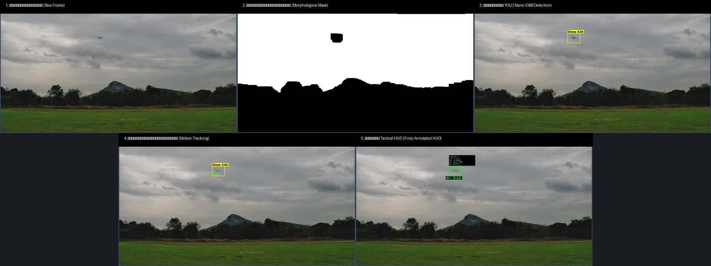

# AI-Based Drone Detection, Localization & Tracking System

[](https://www.python.org/)
[](https://github.com/astral-sh/uv)
[](https://github.com/ultralytics/ultralytics)
[](https://www.raspberrypi.com/)
[](tests/)

A drone detection, geolocation, and multi-object tracking pipeline built for the **TESA Top Gun Rally 2025 – Defensive Track** (11–13 Nov 2025). It combines classical morphological target extraction with YOLO11 Oriented Bounding Box (OBB) detection, fuses the two candidate sets, tracks drones across video frames, estimates each confirmed drone's latitude, longitude, and altitude from its image geometry with gradient-boosted decision trees (GBDT), and renders a HUD overlay plus a First Alert telemetry payload. The design targets CPU-only edge hardware (Raspberry Pi 5, no AI accelerator).

This repository is a cleaned-up, unit-tested reimplementation of the original competition code. The figures in [Results](#results) come from the archived logs of the original competition runs.

---

## Architecture Overview



---

## 5-Stage Processing Pipeline



1. **Stage 1 (Raw Input)**: Full-resolution frame from the fixed ground-station camera.
2. **Stage 2 (Binarization & Morphology)**: Grayscale thresholding separates bright sky from dark targets; the mask is inverted, dilated with a 50×50 kernel to merge fragmented rotor blobs, then eroded and closed before contours are area-gated.
3. **Stage 3 (Detection & Fusion)**: YOLO11-OBB runs on a copy of the frame with the background dimmed and the OSD timestamp banner and foliage band masked out; its boxes are fused with the morphological candidates using IoU, shape-plausibility, and motion scores.
4. **Stage 4 (Multi-Object Tracking)**: Greedy nearest-centroid association. A track is confirmed after 3 matched detections and kept alive through up to 30 missed frames, so IDs can survive short dropouts.
5. **Stage 5 (HUD & Localization)**: Confirmed tracks get GBDT-estimated latitude, longitude, and altitude (MSL), drawn on the output video with track ID and detection confidence.

---

## Quick Start (with `uv`)

All environments and dependencies are managed via [`uv`](https://github.com/astral-sh/uv):

```bash
# 1. Clone repository and initialize virtual environment
uv sync --extra dev

# 2. Review model setup instructions
# (See models/README.md for downloading or training models)

# 3. Run video tracking
uv run python scripts/track_video.py input.mp4 -o output_tracked.mp4

# 4. Run full unit test suite
uv run pytest tests/ -v
```

---

## System Modules

| Module | Core Scripts | Description |
| :--- | :--- | :--- |
| **1. Detection** | [`scripts/detect_images.py`](scripts/detect_images.py)<br>[`scripts/tune_confidence.py`](scripts/tune_confidence.py) | Morphological candidate extraction + YOLO11-OBB inference, optional SAHI sliced inference for small targets, and a confidence-threshold sweep tool. |
| **2. Localization** | [`scripts/localize_drones.py`](scripts/localize_drones.py)<br>[`scripts/train_gbdt.py`](scripts/train_gbdt.py) | 20-dimensional image-geometry features (normalized position, box size and aspect, radial/polar terms, corner distances) fed to 3 independent GBDT regressors for latitude, longitude, and altitude. |
| **3. Tracking & Telemetry** | [`scripts/track_video.py`](scripts/track_video.py)<br>[`scripts/generate_submission.py`](scripts/generate_submission.py) | Stateful multi-target tracking, HUD overlay rendering, and a First Alert JSON payload builder (Base64 frame + per-track coordinates) with optional HTTP POST dispatch, disabled by default. |

---

## Results

> **Where these numbers come from.** All figures are self-evaluations recovered from the archived logs of the original competition runs (November 2025). They were produced by the original competition code, not re-run with this repository. Official competition scores were computed on a private test set (no public leaderboard) and are not part of the archive.

| Area | Metric | Result | Evaluated on |
| :--- | :--- | :--- | :--- |
| **Detection:** YOLO11n-OBB (`train6`, final epoch) | mAP@50 | **97.7%** (precision 97.6%, recall 96.2%) | Validation split of a 14-image Roboflow dataset: 3 video frames (84 labeled drones), interleaved with the 10 training frames |
| **Drone counting:** SAHI + YOLO11-OBB | Exact per-image count accuracy | **77.08%** (74/96 images), count RMSE 0.568 | 96 labeled sample images. Best point of a confidence sweep (conf = 0.75) chosen on the same images. The checkpoint used isn't recorded, and 19 of the images are in the `drone.v3`/`drone.v4` training split |
| **Localization:** full pipeline | Competition weighted error (0.70 × angle + 0.15 × height + 0.15 × range) | **3.33** (angle 3.20°, height 1.90 m, range 5.38 m) | 459 detections on 413 labeled **training** images. The regressors were trained on this same labeled set, so this is a training-set score, not a held-out test |
| **Localization:** GBDT regressors | Mean absolute error | Altitude **2.93 m**, latitude ≈ 4.5 m, longitude ≈ 4.6 m | 20% held-out split (83 samples) in a separate training run |

**Not quantitatively evaluated:** no tracking ground truth was available, so ID switches, MOTA, and IDF1 are not reported. On-device throughput and latency on the Raspberry Pi 5 have not been benchmarked. In the First Alert payload, `velocity_mps` and `direction_deg` are not computed yet and are sent as `null`.

Per-run training tables, the full confidence sweep, and error distributions are in [`docs/01_object_detection.md`](docs/01_object_detection.md) and [`docs/02_drone_localization.md`](docs/02_drone_localization.md).

**Hardware:**
- **Deployment target**: Raspberry Pi 5 (ARM Cortex-A76 CPU, 4GB/8GB RAM, no dedicated GPU or AI accelerator). The nano detector and tree-based regressors were chosen for this budget.
- **Training**: CUDA GPU.

---

## Repository Structure

```
AI-Drone-Detection/
├── README.md
├── LICENSE
├── IMPLEMENTATION_PLAN.md              # File-by-file reimplementation plan
├── pyproject.toml                      # Project config for uv
├── uv.lock
├── config/
│   └── default.yaml                    # Master parameter configuration
├── defense/
│   ├── __init__.py
│   ├── config.py                       # YAML configuration loader
│   ├── detection/
│   │   ├── __init__.py
│   │   ├── image_processor.py          # Classical morphological CV pipeline
│   │   ├── yolo_detector.py            # YOLO11-OBB inference wrapper
│   │   ├── sahi_detector.py            # Slicing Aided Hyper Inference
│   │   └── confidence_tuner.py         # Automated threshold sweep optimizer
│   ├── localization/
│   │   ├── __init__.py
│   │   ├── feature_encoder.py          # 20-dim spatial feature encoder
│   │   ├── gbdt_regressor.py           # Multi-target GBDT regressor (lat, lon, alt)
│   │   ├── fusion_engine.py            # YOLO + morphology candidate fusion
│   │   └── evaluation.py               # Competition evaluation metrics
│   ├── tracking/
│   │   ├── __init__.py
│   │   ├── drone_track.py              # Stateful DroneTrack dataclass
│   │   ├── tracker.py                  # VideoTracker multi-target engine
│   │   ├── hud_renderer.py             # HUD overlay renderer
│   │   └── telemetry.py                # First Alert payload builder & dispatcher
│   └── utils/
│       ├── __init__.py
│       ├── logger.py                   # Timestamped, module-prefixed stdout logger
│       ├── video_io.py                 # Video reader/writer helpers
│       ├── image_io.py                 # Image I/O helpers
│       └── geometry.py                 # Geodesic Haversine & bearing math
├── scripts/
│   ├── detect_images.py                # Problem 1: Batch image detection
│   ├── localize_drones.py              # Problem 2: Full localization pipeline
│   ├── track_video.py                  # Problem 3: Video tracking with HUD
│   ├── train_gbdt.py                   # GBDT training script
│   ├── tune_confidence.py              # Confidence threshold optimization
│   ├── prepare_dataset.py              # Video-to-YOLO dataset creator
│   └── generate_submission.py          # Competition CSV submission formatter
├── notebooks/
│   └── train_yolo_obb.ipynb            # YOLO11-OBB fine-tuning notebook
├── models/
│   ├── .gitkeep
│   └── README.md                       # Model weight acquisition guide
├── docs/
│   ├── 01_object_detection.md
│   ├── 02_drone_localization.md
│   ├── 03_drone_tracking.md
│   ├── 04_edge_deployment.md
│   ├── architecture.md
│   └── assets/                         # Visual artifacts and charts
├── tests/
│   ├── test_drone_track.py
│   ├── test_feature_encoder.py
│   ├── test_fusion_engine.py
│   ├── test_gbdt_regressor.py
│   ├── test_geometry.py
│   ├── test_image_processor.py
│   └── test_tracker.py
└── .gitignore
```

---

## License

This project is licensed under the MIT License - see the [LICENSE](LICENSE) file for details.
