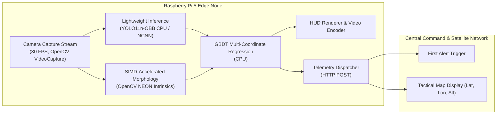

# Edge Deployment, System Integration & Reproduction Guide
## Embedded Execution on Raspberry Pi 5 & Telemetry Architecture

---

## 1. Edge Deployment Architecture: Raspberry Pi 5

The TESA 2025 Defensive challenge required designs to be viable for operational deployment on resource-constrained embedded edge computers:
- **Target Hardware**: **Raspberry Pi 5 (8 GB RAM)**
- **Processor**: Broadcom BCM2712 Quad-core ARM Cortex-A76 @ 2.4 GHz
- **AI Hardware Restriction**: **No external AI accelerator board** (no Coral TPU, no Hailo-8, no discrete GPU). All workloads must execute natively on ARM CPU or onboard VideoCore VII.



### 1.1 CPU Performance Optimizations
1. **Detect only where something is**:
   - Morphology (threshold + 50×50 dilation, about 6 ms per 1080p frame on the desktop CPU) proposes candidates.
   - YOLO11n-OBB (~2.65M parameters) then runs only on native-resolution 320 px crops around them (about 15 ms per crop on the desktop CPU), instead of on the whole frame. This is both faster and more accurate than whole-frame inference; see [01 §3.3](01_object_detection.md).
   - Without YOLO weights the pipeline falls back to morphological candidates only, which avoids neural inference entirely.
2. **Lightweight Coordinate Estimation**:
   - `geo_localizer.bin` holds three shallow GBDT ensembles (200 trees, depth ≤ 5) for bearing, distance and height, evaluated on CPU in about 1 ms per confirmed track. The localization stage needs no neural network.
3. **No full-frame float math**:
   - The previous pre-YOLO `clean_image` step (float32 dimming of the whole frame, 45 ms) is no longer on the detection path. Where it is still used, it now runs as uint8 OpenCV operations.

### 1.2 Measured Desktop CPU Throughput
**Setup:** `scripts/benchmark_pipeline.py` times the real tracking pipeline (`config/default.yaml`) stage by stage, on a **desktop Intel Core i5-14500 CPU (Windows 11, no GPU)** over 1080p, 25 fps competition footage.
- **Runs:** each run is a fresh process; the first 20 frames are excluded as warm-up.
- **Before vs after:** the previous pipeline (commit `839dcdd`, from a git worktree) and the current one ran back to back on the same videos, 2 runs × 600 frames each.
- **This is not a Raspberry Pi 5 measurement**; the Pi results are in §1.3.

| Video | Before (`clean_image` → YOLO 640 on the whole frame) | **After** (YOLO on 320 px raw crops around candidates) | Speed-up |
| :--- | :---: | :---: | :---: |
| `P1_VIDEO_5` (2 drones) | 90.9 ms/frame (≈ 11 FPS) | **51.6 ms/frame (19.4 FPS)**, p95 56.1 ms | 1.8× |
| `P1_VIDEO_4` (1 drone) | 87.8 ms/frame (11.4 FPS) | **35.1 ms/frame (28.0 FPS)**, p95 43.9 ms | 2.5× |

| Stage (median ms per frame, `P1_VIDEO_5`) | Before | After |
| :--- | :---: | :---: |
| Video decode | 3.2 | 2.8 |
| Grayscale + threshold | (inside morphology) | 1.7 |
| Morphology (`ImageProcessor.process`) | 6.3 | 4.2 |
| Background cleaning (`clean_image`) | **45.5** | removed from the path |
| YOLO11n-OBB | 23.9 (one 640 px frame) | 30.6 (two 320 px crops, ≈ 15 ms each) |
| Tracking, fusion | 0.3 | 0.5 |
| Localization | 2.1 | 1.9 |
| HUD render | 1.5 | 1.5 |
| Video write (mp4v, 1080p) | 8.6 | 8.5 |

**Where the time goes now:**
- YOLO cost scales with the number of morphological candidates, about one crop per drone-like object in view. A sky full of birds or dark clouds costs more than the clean footage measured here.
- Writing the annotated 1080p video is now about a sixth to a quarter of each frame. It is output overhead, not detection.

**Caveats:**
- The machine was not fully idle (mean background load 12% during the "before" runs, 5.5% during the "after" runs).
- One "before" run on `P1_VIDEO_5` was visibly disturbed (8.3 FPS against 11.2 FPS). The table uses medians pooled over all frames, which are robust to that.

**NCNN backend.** The detector can also be exported to NCNN, the fastest CPU backend Ultralytics supports on ARM. On the held-out detection set the NCNN export gives identical results (F1 0.947, 39/43 counts). On this x86 desktop it is about as fast as PyTorch (13.5 vs 14.3 ms per 320 px crop); on the Pi's ARM cores it is about 6.7× faster (§1.3).

### 1.3 Measured on a Raspberry Pi 5
**Board:** Raspberry Pi 5 Model B, 8 GB, 4× Cortex-A76 at up to 2.4 GHz, official active cooler, Debian 13 (Raspberry Pi OS), Python 3.13, CPU only.
- **Software:** torch 2.14.1+cpu, ultralytics 8.4.157, OpenCV 5.0, ncnn 1.0.20260526.
- **Protocol:** same benchmark and settings as §1.2, 2 runs × 600 frames per video and backend, first 20 frames excluded.
- **Conditions:** background CPU load before the runs was 0.1–0.5%. The SoC stayed at 52–60 °C, and `vcgencmd get_throttled` reported `0x0` (never throttled) before and after.

| 1080p video | PyTorch (`yolo11n-obb.pt`) | **NCNN** (`yolo11n-obb_ncnn_model`, 320 px) |
| :--- | :---: | :---: |
| `P1_VIDEO_5` (2 drones) | 3.9 FPS (255 ms/frame) | **12.5 FPS** (77 ms/frame, p95 91 ms) |
| `P1_VIDEO_4` (1 drone) | 6.6 FPS (145 ms/frame) | **16.9 FPS** (56 ms/frame, p95 74 ms) |

| Stage (median ms per frame, `P1_VIDEO_5`, NCNN) | ms |
| :--- | :---: |
| Video decode (1080p H.264, CPU) | 3.3 |
| Grayscale + threshold | 2.4 |
| Morphology | 9.6 |
| YOLO11n-OBB, 2 crops (≈ 16 ms each) | 38.7 |
| Tracking + fusion | 0.4 |
| Localization (GBDT, 2 tracks) | 2.8 |
| HUD render | 1.4 |
| Video write (mp4v, 1080p) | 17.8 |

**Takeaways:**
- **NCNN is essential on the Pi.** It makes YOLO about 6.7× faster per crop than PyTorch (16 against 105 ms) and the whole pipeline 2.6–3.2× faster. Accuracy is unchanged: on the Pi, the held-out detection F1 (0.947) and count accuracy (39/43) are identical for both backends and match the desktop.
- **Writing the annotated 1080p video is the second-largest cost** (about 18 ms). A deployment that only sends First Alert telemetry would not pay it.
- **Not full frame rate.** The source video is 25 fps, so the Pi processes about half to two-thirds of the frames in real time. Cost grows with the number of drone-like candidates in view.

**Reproduce:**

```bash
# On the Pi (no sudo needed)
curl -LsSf https://astral.sh/uv/install.sh | sh
git clone <this repository> && cd AI-Drone-Detection   # check out the branch being measured
uv sync --extra edge                                    # CPU-only torch on ARM (~1.4 GB environment)

# From the PC: copy the detector, the trained localizer and a test video (not in git)
scp models/yolo11n-obb.pt models/geo_localizer.bin <user>@<pi>:~/AI-Drone-Detection/models/
scp data/p3_video/P1_VIDEO_5.mp4 <user>@<pi>:~/AI-Drone-Detection/data/p3_video/

# On the Pi: export the detector to NCNN once (320 px input = the crop size)
uv run python -c "from ultralytics import YOLO; YOLO('models/yolo11n-obb.pt').export(format='ncnn', imgsz=320)"

# Track with NCNN, or benchmark
uv run python scripts/track_video.py data/p3_video/P1_VIDEO_5.mp4 -o out.mp4 --yolo-model models/yolo11n-obb_ncnn_model
uv run python scripts/benchmark_pipeline.py data/p3_video/P1_VIDEO_5.mp4 --threads default --repeats 2 \
    --yolo-model models/yolo11n-obb_ncnn_model --output data/bench_pi_ncnn.json
```

The benchmark records the board model, SoC temperature and throttling flags, so a throttled run is visible in its JSON.

---

## 2. Satellite & Command Telemetry: "First Alert" API Specification

Per contest guidelines (`TESA 2025 2a58d292ccc28118a299d224b20ea387.md`), edge nodes must transmit structured telemetry to central command upon initial target acquisition ("First Alert"):

### 2.1 First Alert JSON Payload Schema
```json
{
  "timestamp": 1731478200,
  "station_id": "STATION_ALPHA_RPi5",
  "camera_position": {
    "latitude": 14.305029,
    "longitude": 101.173010,
    "altitude_msl": 37.2
  },
  "alert_type": "FIRST_DETECTION",
  "total_drones_detected": 2,
  "objects": [
    {
      "frame_id": 142,
      "track_id": 1,
      "classification": "DJIMavic",
      "confidence": 0.892,
      "latitude": 14.30485,
      "longitude": 101.17280,
      "altitude_msl": 40.52,
      "velocity_mps": 12.4,
      "direction_deg": 45.2,
      "distance_m": 28.5,
      "bbox": {
        "center_x": 1240,
        "center_y": 480,
        "width": 64,
        "height": 38,
        "theta_deg": 12.5
      }
    },
    {
      "frame_id": 142,
      "track_id": 2,
      "classification": "FPV_Quadcopter",
      "confidence": 0.785,
      "latitude": 14.30462,
      "longitude": 101.17265,
      "altitude_msl": 52.10,
      "velocity_mps": 18.1,
      "direction_deg": 112.0,
      "distance_m": 42.1,
      "bbox": {
        "center_x": 780,
        "center_y": 320,
        "width": 42,
        "height": 28,
        "theta_deg": -5.0
      }
    }
  ],
  "image_base64": "/9j/4AAQSkZJRgABAQAAAQABAAD/2wBDAAYEBQYFBAYGBQYHBwYIChAKCgkJ..."
}
```

> **Note:** This is an illustrative payload expanded from the contest's First Alert format (time; per-object frame, id, type, lat, lon, velocity, direction; `image_base64`), not output captured from this system. This repo's `TelemetryDispatcher` currently sets `classification` to `"Drone"`, sends `velocity_mps` and `direction_deg` as `null`, does not emit `distance_m` or `theta_deg`, and only POSTs when `telemetry.enabled` is set with an endpoint (off by default).

---

## 3. Project Archive Inventory

All code, trained weights, datasets, and configuration artifacts are archived across five archives in `Archived Project/`:

```
c:\Users\Atomic\Downloads\TESA 2025 Reorganize\Archived Project\
│
├── tesa.zip (2.28 GB)
│   ├── ai-collab/tesa/1clean_background/          # Morphological filtering prototypes
│   ├── ai-collab/tesa/runs/obb/                   # YOLO OBB training iterations (train to train13)
│   │   ├── train6/                                # YOLO11n-OBB edge model
│   │   ├── train7/                                # YOLO11x-OBB baseline
│   │   ├── train9/                                # YOLO11x-OBB refined
│   │   ├── train10/                               # Champion YOLO11x-OBB (99.5% mAP50, 200 epochs)
│   │   └── train11/                               # YOLO11x-OBB on v3 dataset
│   ├── ai-collab/tesa/2gen_boundbox/
│   │   ├── generate_predictions.py                # SAHI-sliced prediction generator
│   │   ├── visualize_from_csv.py                  # Visual verification overlay tool
│   │   └── predictions_train*.csv                 # Formatted submission predictions
│   ├── ai-collab/tesa/train.ipynb                 # CUDA environment setup & training notebook
│   └── ai-collab/tesa/track.ipynb                 # Tracking development notebook
│
├── tesa2025_defense.zip (142 MB)
│   ├── ai-collab/tesa2025_defense/runs/obb/train/ # Training logs, confusion matrices, BoxPR/F1 curves
│   └── ai-collab/tesa2025_defense/train.ipynb     # Notebook for YOLOv8 OBB training
│
├── tesa_day2_localization.zip (628 MB)
│   ├── ai-collab/tesa_day2_localization/
│   │   ├── train_model.py                         # Deep Learning CNN localization (EfficientNet-B0)
│   │   ├── evaluate_predictions.py                # Scoring script implementing the competition formula
│   │   ├── evaluation_results.csv                 # 459 detections on training images (Total Error = 3.33)
│   │   └── P2_DATA_TRAIN/                         # Paired .jpg and .csv ground truth
│   └── ai-collab/tesa_day2_localization/tesa_kiss_with_yolo/
│       ├── aerial_ml_tracker_yolo_softfusion.py   # Soft-Fusion GBDT regression engine
│       ├── generate_submission_improved.py        # Final submission generator
│       └── submission_improved.csv                # Formatted localization submission
│
├── tesa_day3.zip (4.51 GB)
│   ├── ai-collab/tesa_day3/drone_video_tracker.py # 1,260-line master video tracking & HUD system
│   └── ai-collab/tesa_day3/United.ipynb           # Integration & multi-mode fusion experiments
│
└── tesa_new.zip (140 MB)
    ├── ai-collab/tesa_new/1clean_background/
    │   ├── main.py                                # Pipeline driver
    │   └── defense/                               # Clean architecture Python CV package
    └── ai-collab/tesa_new/2yolo/
        ├── auto_tune_confidence.py                # Automated confidence threshold optimizer
        ├── confidence_tuning_results*.csv         # Confidence sweep logs
        ├── sahi_yolo11_obb_image.py               # SAHI single-image inference
        └── sahi_yolo11_obb_video_eta.py           # SAHI video inference with ETA calculator
```

---

## 4. Quick Reproduction & Execution Commands

### 4.1 Running Problem 1: Object Detection (OBB + SAHI)
```bash
# 1. Generate predictions with SAHI slicing and polygon-to-center conversion
python generate_predictions.py \
  --model runs/obb/train10/weights/best.pt \
  --test_dir test_images/ \
  --output predictions.csv \
  --slice 640 \
  --overlap 0.25 \
  --conf 0.75 \
  --device 0

# 2. Inspect visualized bounding boxes
python visualize_from_csv.py \
  --image_dir test_images/ \
  --csv_file predictions.csv \
  --output_dir visual_verification/
```

### 4.2 Running Problem 2: Drone Localization (Soft-Fusion GBDT)
```bash
# 1. Train multi-output GBDT models and evaluate on training set
python aerial_ml_tracker_yolo_softfusion.py \
  --src P2_DATA_TRAIN/ \
  --dbg debug_localization/ \
  --out drone_predictions.csv \
  --yolo-model best.pt \
  --conf 0.75 \
  --fusion soft \
  --device 0

# 2. Score predictions with the competition formula (training-set evaluation)
python evaluate_predictions.py \
  --predictions drone_predictions.csv \
  --ground-truth P2_DATA_TRAIN/ \
  --plot
```

### 4.3 Running Problem 3: Video Tracking with Adaptive Fusion & HUD
```bash
# Execute master video tracking engine with adaptive track-continuity fusion
python drone_video_tracker.py input_drone_video.mp4 \
  -o output_tracked_hud.mp4 \
  --yolo-model best.pt \
  --yolo-conf 0.75 \
  --fusion adaptive \
  --models models/ \
  --debug debug_stages/ \
  --device 0
```
